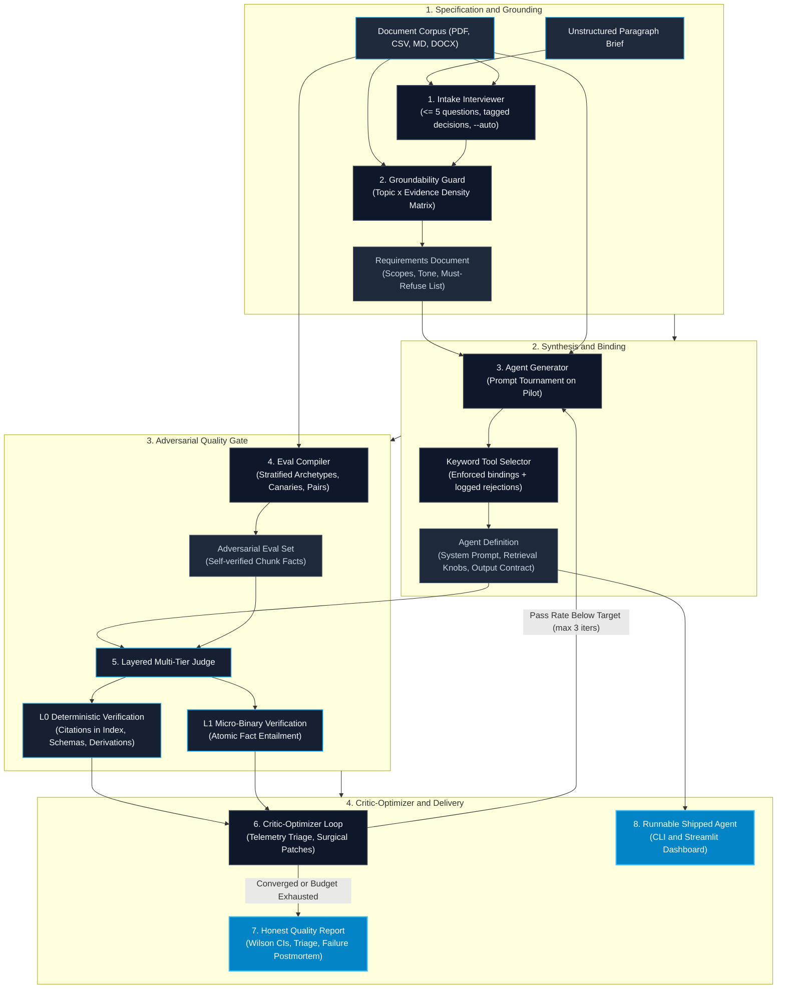

# ForgeAI — Autonomous Agent Factory

ForgeAI is an autonomous system that takes a single paragraph brief and a folder of documents, interviews the requester, drafts a declarative agent specification, compiles an adversarial evaluation set directly from document ground-truth, judges the results using a layered deterministic-first scorer, diagnoses failure modes from execution telemetry, applies surgical versioned patches, and delivers a tested, runnable agent accompanied by a verified quality report.

> **Live Deployment:** [Hugging Face Space](https://huggingface.co/spaces/kt0015/oceanai) | **Direct Web App:** [kt0015-oceanai.static.hf.space](https://kt0015-oceanai.static.hf.space)
>
> **Core Engineering Thesis:** Control flow, retrieval validation, arithmetic derivation, and score aggregation are code. The model proposes typed candidates; code disposes.

---

## Executive Summary and Benchmark Results

ForgeAI was evaluated across three distinct domains, including two complex multi-modal benchmark environments and an unseen domain cold run:

| Benchmark Run | Domain and Corpus | Tools Attached | Score (95% Wilson CI) | Hardness Profile |
|---|---|---|---|---|
| **ShoreHR Policy** | Shore-staff HR policy document | 0 (all 4 tools rejected with logged rationale) | **86% [60% - 96%]** (vs. Human Baseline: **71% [45% - 88%]**) | Factual recall, policy boundary traps, leave entitlements |
| **PortOps Marine** | Berth schedule CSV + bunker prices CSV + port tariff rules | 4 (CSV lookup, arithmetic calculator, date/time, Open-Meteo marine API) | **61% [39% - 80%]** | Multi-table lookup, temporal filtering, deterministic tariff derivation |
| **University Library** | University library lending regulations (unseen domain) | 0 (tools rejected) | **79% [57% - 91%]** | Multi-tier borrowing limits, overdue sanctions, tier hierarchy |

All artifacts, prompt tournament logs, iteration trajectories, and failure postmortems are committed under `forgeai/demos/`.

---

## Architecture and Capability Matrix

| Capability | Implementation Module | Architecture and Evidence |
|---|---|---|
| **Intake Interviewer** | `src/forge/intake/interviewer.py` | Asks up to 5 clarifying questions tagged to specific architectural decisions; `--auto` mode derives conservative defaults without blocking. Generated requirements: `demos/*/run/requirements.json`. |
| **Groundability Guard** | `src/forge/intake/groundability.py` | Constructs a topic-by-evidence density matrix. Unsupported topics are automatically rewritten to must-refuse topics. Groundability overrides are logged in `demos/*/run/report.md`. |
| **Declarative Generator** | `src/forge/generate/generator.py` | Emits declarative `AgentDefinition` with system prompt, retrieval hyperparameters, tool bindings, and strict JSON output contract. Tools are attached only when justified by brief keywords. |
| **Adversarial Compiler** | `src/forge/evals/compiler.py` | Synthesizes at least 15-20 adversarial test cases per run across answerable lookups, out-of-scope refusals, premise canaries, and rephrase pairs. Expected facts must pass an answerability self-check against source chunks. |
| **Layered Multi-Tier Judge** | `src/forge/judge/judge.py`, `src/forge/judge/stats.py` | Combines L0 deterministic checks (citation ID validity, numeric tolerance and containment, refusal schema adherence) with L1 micro-binary claim scoring. Calculates Wilson score confidence intervals. |
| **Critic-Optimizer Loop** | `src/forge/critic/optimizer.py`, `src/forge/critic/patches.py` | Classifies failures into four concrete failure classes (retrieval miss, prompt defect, hallucination, wrong refusal). Applies surgical versioned prompt sections or retrieval widenings (max 3 iterations) with patient early stopping. |
| **Transparent Reporting** | `src/forge/report.py` | Generates a transparent Markdown quality report detailing scorecard trajectories, tool rejection rationales, iteration deltas, and remaining failure postmortems. Committed at `demos/*/run/report.md`. |
| **Generic Chat Runtime** | `src/forge/runner/engine.py`, `src/forge/cli.py`, `ui/app.py` | Generic runtime that loads any declarative agent definition. Accessible via CLI (`forge chat`) or the Streamlit web dashboard. |
| **Domain Demonstrations** | `demos/hr/`, `demos/portops/`, `demos/library/` | Complete end-to-end runs committed with requirements, definitions, generated eval sets, SQLite vector/FTS databases, scorecards, and reports. |

### Advanced Platform Features

- **Prompt Tournament:** `src/forge/critic/optimizer.py` generates 3 candidate prompts and conducts an adversarial tournament on a pilot set (3 answerable, 2 traps) before selecting the production candidate.
- **Budget Enforcement:** Token counts and millisecond latencies are tracked per stage in `demos/*/run/ledger.json` with early stopping if patch gain falls below threshold.
- **Human Verification Checkpoint:** `--interactive` flag in `forge build` presents the generated requirements document for human review and edit before agent generation proceeds.
- **Factory vs. Human Baseline:** A hand-written baseline was authored and evaluated against the identical eval set in `demos/hr/baseline_human/`. The factory achieved 86% vs. human 71% (+15 percentage point advantage).
- **Regression and Drift Detection:** `forge regression <run_dir> --docs <new_docs>` compares old eval cases against a refreshed document corpus to detect regressions and eval drift.
- **Web Studio and Runner Dashboard:** Streamlit control panel (`ui/app.py`) featuring an interactive pipeline flow, prompt runner with chunk provenance inspection, and comparative benchmark suite.

---

## Architecture



---

## Design Principles

1. **LLM Proposes, Code Disposes:** The model only generates candidate structured slots. Control flow, validation loops, score calculations, and tool sandboxing are executed by deterministic Python code.
2. **Decomposed Micro-Binary Judging:** Never ask a small model for an open-ended subjective grade. Decompose validation into atomic binary questions and let code compute coverage, omission, and invention.
3. **Strict Provenance and Typed Schemas:** Every document chunk, claim, test case, verdict, and patch maintains full provenance back to its originating document, chunk ID, or prompt version.
4. **Adversarial Self-Distrust:** The factory validates its own test cases before running them: facts must be proven by source chunks, and refusal questions must pass an answerability check to eliminate false canaries.
5. **Radical Transparency:** The report explicitly lists remaining failures, explains why they failed, and documents tool rejections and groundability disagreements.

---

## Quickstart

### Prerequisites

- Python 3.10+ (tested on Python 3.11)
- Ollama running locally with `qwen2.5:7b-instruct` and `nomic-embed-text`

```bash
# Pull recommended local models
ollama pull qwen2.5:7b-instruct
ollama pull nomic-embed-text
```

### Installation

```bash
cd forgeai

# Create virtual environment and activate
python -m venv .venv
# Windows:
.venv\Scripts\activate
# Linux/macOS:
# source .venv/bin/activate

# Install package in editable mode with test and UI dependencies
pip install -e ".[dev,ui]"
```

### Running Tests

```bash
python -m pytest tests -v
```

### CLI Commands

```bash
# 1. Build an agent unattended from brief and documents
forge build --brief demos/hr/brief.md --docs demos/hr/docs --out runs/hr_agent --auto

# 2. Interactive chat with the generated agent
forge chat runs/hr_agent

# 3. Compile and score evaluation cases
forge evaluate runs/hr_agent

# 4. Run the critic-optimizer loop
forge optimize runs/hr_agent

# 5. Display the honest quality report
forge report runs/hr_agent

# 6. Test for regressions against modified documents
forge regression runs/hr_agent --docs demos/hr/docs
```

### Launching the Web Dashboard

```bash
streamlit run ui/app.py
```

---

## Repository Structure

```
.
├── README.md                                                 # Top-level platform overview and quickstart
└── forgeai/
    ├── pyproject.toml                                        # Project metadata and dependencies
    ├── README.md                                             # Package-level documentation
    ├── src/forge/
    │   ├── cli.py                                            # Typer CLI application entry point
    │   ├── core.py                                           # Typed data models (Chunk, Provenance)
    │   ├── spec.py                                           # AgentDefinition, ToolBinding, OutputContract
    │   ├── evaltypes.py                                      # EvalCase, Verdict, Scorecard, RunManifest
    │   ├── llm.py                                            # Ollama backend and JSON repair harness
    │   ├── report.py                                         # Honest Markdown report generator
    │   ├── regression.py                                     # Regression engine and drift detector
    │   ├── intake/                                           # Interviewer and groundability guard
    │   ├── generate/                                         # Agent definition generator
    │   ├── evals/                                            # Stratified adversarial eval compiler
    │   ├── judge/                                            # Layered judge (L0 deterministic + L1 binary)
    │   ├── critic/                                           # Critic-optimizer loop and patch library
    │   ├── retrieve/                                         # BM25 keyword index and sqlite-vec store
    │   ├── runner/                                           # Generic agent chat runtime
    │   └── tools/                                            # Tool registry (CSV, calculator, date, marine)
    ├── tests/                                                # Unit test suite (18 unit tests)
    ├── prompts/                                              # 11 numbered prompts referenced by hash
    ├── demos/
    │   ├── hr/                                               # ShoreHR artifacts and human baseline
    │   ├── portops/                                          # PortOps Marine artifacts (all 4 tools)
    │   ├── library/                                          # University Library lending rules
    │   └── synth/                                            # Document synthesis intent documentation
    └── ui/
        └── app.py                                            # Control dashboard
```
