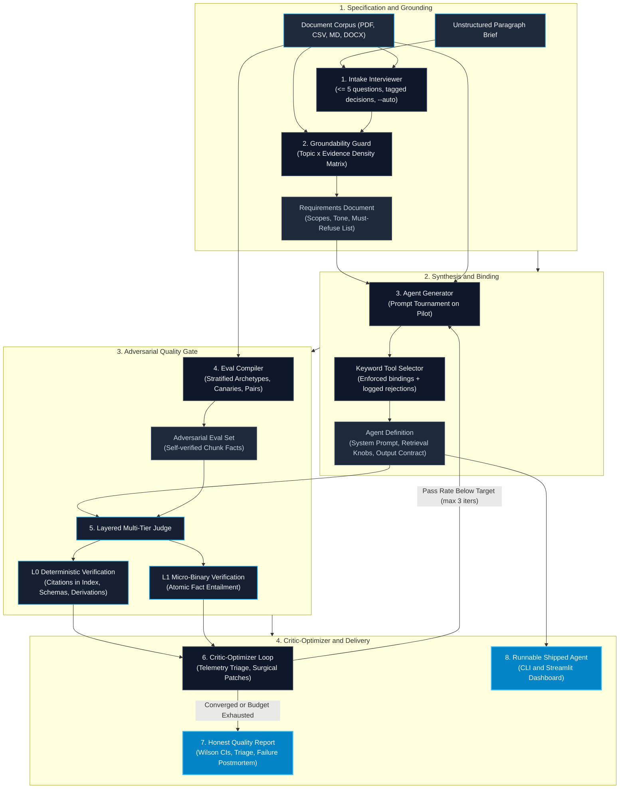

# ForgeAI

**The agent that builds agents.** Give it a one-paragraph brief and a folder of
documents; it interviews the requester, drafts the agent, compiles an adversarial
eval set from the documents themselves, judges the results with a layered
deterministic-first scorer, diagnoses failures from retrieval telemetry, applies
surgical patches, and ships a runnable agent plus an honest quality report.

> Core thesis: **never ask a small model for an opinion — ask it a thousand
> yes/no questions and let code add up the answers.**

Everything runs local-first on a 7B open model (Ollama, `qwen2.5:7b-instruct`) — no cloud
dependencies in the factory itself.

## Quickstart

```bash
cd forgeai
python -m venv .venv && .venv\Scripts\activate
pip install -e ".[dev,ui]"

# ollama with the models pulled:
#   ollama pull qwen2.5:7b-instruct && ollama pull nomic-embed-text

# build an agent from a brief + document folder (unattended by default)
forge build --brief demos/hr/brief.md --docs demos/hr/docs --out runs/myagent --auto

# talk to the produced agent
forge chat runs/myagent

# compile evals, run them, judge them, score honestly
forge evaluate runs/myagent

# the critic-optimizer loop: triage -> one surgical patch -> re-eval
forge optimize runs/myagent

# the honest report (the product; the agent is evidence)
forge report runs/myagent

# documents changed? re-run the old eval set, see what broke
forge regression runs/myagent --docs demos/hr/docs

# optional UI (Factory / Runner / Evidence tabs)
streamlit run ui/app.py
```

## Architecture



## Design principles

1. **LLM proposes, code disposes.** Control flow, validation, retries, budget
   and scoring aggregation are Python. The model only fills typed slots
   (Pydantic v2 + JSON repair loop with exact validation errors).
2. **Never ask a small model for an opinion.** Judging decomposes into binary
   micro-calls aggregated mechanically. Deterministic checks dominate; where
   code can decide (numbers, citations, absence-of-evidence), code decides —
   and disagreements with the model are logged, not hidden.
3. **Every artifact is typed and carries provenance.** Chunks, claims, eval
   cases, verdicts, patches — all know which doc/chunk/prompt produced them.
4. **The output contract is the measurement instrument.** One schema serves
   the runner (enforced by the repair loop), the judge (scores against it)
   and the report.
5. **Distrust defaults — verify, then trust.** The eval set defends itself:
   expected facts must survive their own grounding chunk; refusal cases must
   pass an answerability gate; near-duplicates die. Every override is flagged
   in the artifacts.
6. **Honesty is a feature.** Wilson intervals, per-class failure taxonomy,
   unexplained-failure list, cost ledger. The report explains its number.

## The three committed runs

| | Run A — ShoreHR | Run B — PortOps (marine) | Cold Run — Library (unseen) |
|---|---|---|---|
| corpus | HR policy doc | berth-schedule CSV + bunker CSV + tariff doc | library lending rules doc |
| tools attached | 0 (all 4 rejected, reasons logged) | all 4 (incl. live open-meteo marine) | 0 (all tools rejected) |
| score | **86% [60–96%]** | **61% [39–80%]** | **79% [57–91%]** |
| hardness | factual coverage | multi-step arithmetic + date-scoped lookups | borrowing limits + sanctions |

Run B is deliberately harder — the contrast is the evidence of generality.
Library was an unseen domain tested to verify that the factory builds unattended without tuning.
All three reports (`demos/*/run/report.md`) state what still fails and why.

**Factory vs human baseline** (stretch goal): a hand-written agent evaluated
on the same set and judge scored **71% [45–88%]** vs the factory's 86% —
see `demos/hr/baseline_human/` with method and self-preference disclosure.

## Testing

Run the automated test suite with:

```bash
python -m pytest tests -v
```

## What the factory caught in itself (excerpt)

Every guard in this repo was added after a live failure, including:
- eval facts that contradicted their own source chunk (killed at compile time)
- canaries planted on topics the corpus actually covered (answerability gate)
- the tool selector rejecting tools the brief explicitly demanded
  (keyword-rule enforcement, labeled "ENFORCED" in the binding)
- the groundability guard rewriting covered topics into must-refuse,
  making the agent refuse its own core scope (synonym classes + logged
  deterministic override)
- the judge failing correct answers: "USD 4,500" vs "USD 4,500 per call",
  a correct 770.83/hour derivation vs an 18,500/day rule (numeric
  deterministic matching)

Full history in `git log` — every commit documents the failure that
motivated its fix.

## Repository layout

```
src/forge/       intake, generate, evals, judge, critic, runner, tools, regression, report
tests/           automated pytest suite (18 unit tests covering specs, tools, stats, ingest, BM25)
prompts/         11 numbered generation prompts (committed, hash-referenced)
demos/hr/        run A: full artifacts + human baseline + regression-ready
demos/portops/   run B: full artifacts
demos/library/   cold run: third unseen domain full artifacts
demos/synth/     document synthesis intent
ui/app.py        Streamlit: Factory / Runner / Evidence
```


